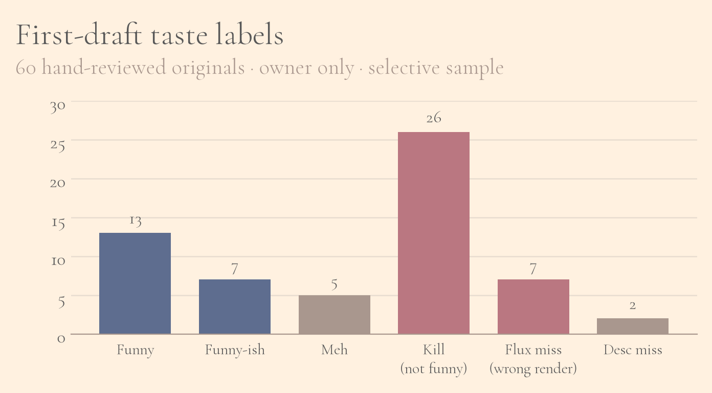
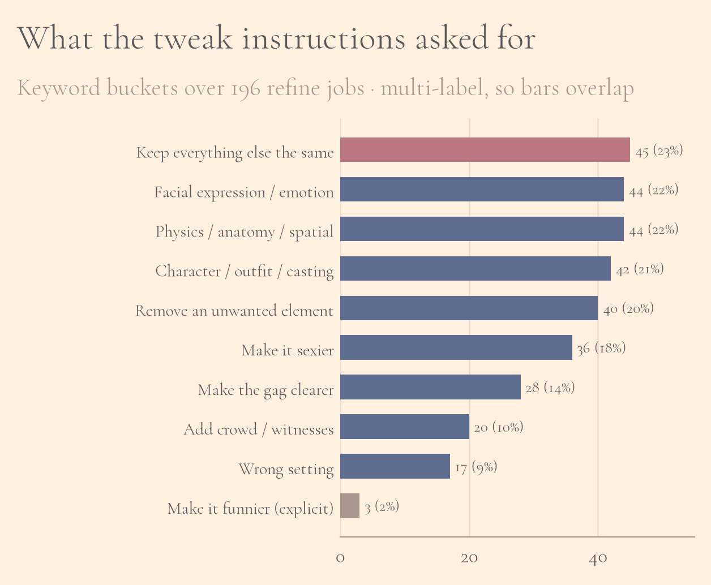
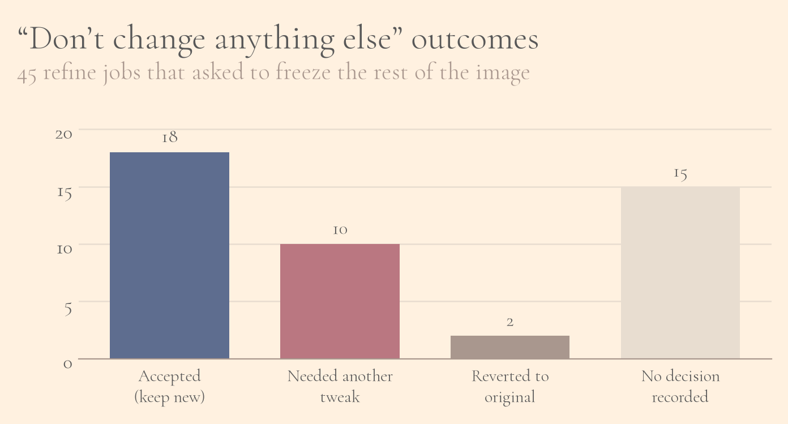
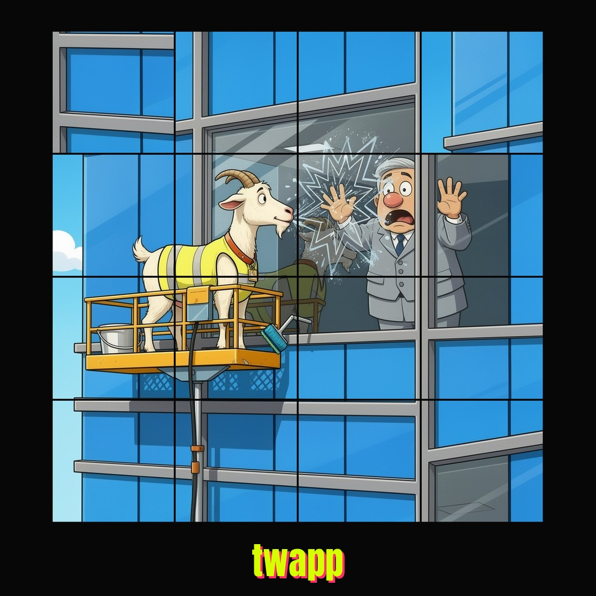
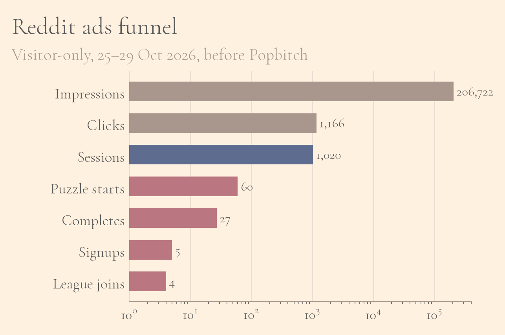
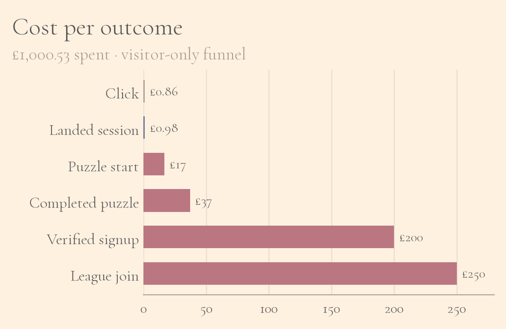

In early October I launched [twapp](https://twapp.me){target="_blank" rel="noopener"}, a daily picture puzzle. Every day there's one crude, hopefully funny image. It gets cut into a grid, and you try to put it back together against the clock. You don't need an account to play the daily game. 

I built it because I'm a Fantasy Premier League obsessive, and I liked the idea of giving WhatsApp groups something similarly competitive and stupid to argue about every day. A friend once sent me a ridiculous goat video, and the basic joke of the game grew out of that kind of shared silliness. You get one messy picture to put back in one piece, and afterwards you compare times.

There was also a more serious reason. A good friend's dad has prostate cancer. He's still alive, but the doctors think he has about ten years. That's the sort of fact that sits with you. For Movember I turned twapp into a public prize league for November. Players get one puzzle a day. If they miss a day, they score nothing for that day. Whoever is top on the 30th gets £100 from me, and I also donate another £100 to Prostate Cancer UK in their name. Separately, I match whatever people give on the [JustGiving page](https://www.justgiving.com/page/twapp-movember-2026){target="_blank" rel="noopener"}, up to £1,000.

Building the website was the part of this project I felt confident about. Getting strangers who arrived from an advert to actually start moving tiles was much harder. By the end of my first proper paid push I'd spent just over £1,000 on Reddit ads and got 60 puzzle starts, five new accounts and four Movember league joins out of it. The AI image pipeline had its own version of the same problem: of the first drafts I bothered to label, more were killed as unfunny than were liked. This is a write-up of both halves.

## Keeping AWS cheap without painting myself into a corner

I wanted the infrastructure to stay cheap when almost nobody was playing, while still being able to survive a sudden rush of traffic without a full rewrite. One suggestion I got early on was to build it as a serverless app from the start: static files on S3 and CloudFront, an API Gateway in front of Lambda, DynamoDB for scores, and Cognito for accounts.

That architecture makes sense if the product is mostly a thin front end that saves a score. Twapp is a Go application with cookie sessions; an admin process where people vote on tomorrow's picture; mini leagues with monthly standings; automated WhatsApp-style roast reports at the end of the month; and a content pipeline for generating the daily image. DynamoDB would have made a lot of the joins and league logic awkward. Cognito would have been another system to learn while I still needed to get the jokes working.

So I kept a fairly ordinary stack. The server is Go with the standard library's HTTP package, Postgres for data, and plain JavaScript and CSS in the browser. There's no Docker. The puzzle images sit on S3 behind CloudFront. The application itself runs on EC2 in an autoscaling group behind an Application Load Balancer. When the site is quiet, that's roughly one `t4g.micro` instance and a `db.t4g.micro` database.

Cheap is relative. Early on, with only about 58 sessions recorded, AWS was already showing roughly $40 in a short window in October. Almost none of that was people playing. I was paying for the load balancer, Postgres, public IPv4 addresses, a WAF in front of the image CDN and Route 53 to be switched on. S3 and CloudFront were pennies. If the game ever did go properly viral, CloudFront would probably hurt before the little EC2 box did. I tagged the resources so I could see what twapp was spending on its own, and set up a spend cap that can scale the autoscaling group down to zero and stop the database if things get silly. AWS won't freeze the account for you. If you want a hard stop you have to build it yourself.

Even getting to that point was messier than the diagram makes it sound. Registering the domain through Route 53 failed, so I bought `twapp.me` from Porkbun instead. The first push to `main` left me looking at a 502 while GitHub Actions and the load balancer disagreed about whether the new instance was healthy.  None of these problems are exotic. They're just the sort that eats an afternoon when you're the only person running the thing.

## Making sure there's a new picture every day

The product only works if tomorrow's gag exists. Each day, a Cursor automation is meant to fill a Photo Studio with candidate images; admins then vote; I lock in a winner. Cursor writes the gags; Flux generates the images; and humans decide on the funniest images. During November I also have characters in Movember moustaches.

One weekend the automation burned through a painful share of my Cursor tokens while producing almost nothing useful, largely because the agent was looping while searching the web for topical ideas. I fixed this by creating server-side logic to automate the agent getting a short gag brief from the server. At one point I had about a quarter of the month's cursor tokens left, with nearly thirty days still to go.

The eventual fix was unglamorous. Stop letting the agent wander around the internet. Feed it a curated line or two from RSS feeds and Google Trends. Treat image generation as a job queue rather than an open-ended chat. But, nevertheless, a reminder in watching over AI to ensure it's not burning through tokens unnecessarily.

Getting the pipeline to fire every day was only half the job. The other half was taste. Through October I generated 557 candidate images for about 43 puzzle days: 373 first drafts and 184 tweak versions. I only hand-labelled taste on a selective sample of first drafts, so these rates are among the ones I bothered to judge, not among every frame Flux ever spat out. Of 60 labelled originals, 13 were funny and 7 funny-ish: about a third positive. Twenty-six were kills because the premise just wasn't funny. Another seven were flux misses where the model rendered the gag wrong. First drafts were more likely to be killed than liked.[^1]

Owner taste labels on 60 hand-reviewed first drafts.

[^1]: A note on those labels, because they're easy to over-read. I'm the only person who applied them. I didn't label anything like every image, and the ones I did label came mostly from the workflow I was already staring at. So the 43% kill rate says something real about the first drafts I reviewed. It doesn't prove that 43% of everything generated in October deserved to die.

Tweaking was how the near-misses survived. I requested 196 refine jobs; 186 finished and 10 failed. Only about one in five originals ever got tweaked at all, but those lineages averaged about 2.4 versions each, and more than half of the refine outputs were tweaks of tweaks, with some chains seven deep. On the 120 tweaks where I recorded a decision, the new image beat the old one 97.5% of the time. That sounds like a win until you notice that 53% of the verdicts were still "keep refining": better, but not done.

The instructions themselves were rarely "make it funnier." That phrase showed up in about 2% of refine jobs. Mostly I was doing art direction: fix the face, fix the physics, remove the postman who leaked in from another seed, make the cast look right. The single most common ask, on 45 of 196 jobs, was some version of "change this one thing and keep everything else the same."

What the tweak prompts actually asked for. Categories overlap.

That freeze instruction is where the model is supposed to be surgical. I'd like to say the next numbers prove it kept redrawing the rest of the picture. They don't, quite. A re-tweak can mean the fix didn't land, or that the new version introduced a fresh problem, or that I simply found another thing to fuss about. What I can say is that the one-pass success rate wasn't high. Of those 45 keep-everything-else jobs, 18 were accepted as the new version; 10 were marked as needing another tweak; two went back to the original; and 15 never got a recorded decision from me at all. Sixteen of the results spawned further refine jobs, 18 follow-up jobs in total, and 15 of those 18 prompts repeated the same "keep everything else constant" guardrail. Repeating myself that often is partly habit, it's also a sign I didn't trust the model to leave the rest alone. One cyclist-versus-taxi-door gag took about seven passes and we still couldn't get the characters in the correct positions for the gag.

Outcomes when I asked Flux to change one thing and freeze the rest.

## Attention is expensive

I first shared twapp in WhatsApp groups. That's useful, and it's also misleading. Friends will try your thing. They will also forgive a Start button, a flashy board, and a half-explained league. Cold traffic won't.

Reddit looked like the natural next place. The trouble is that the communities I wanted treat invite links as spam, and posts with a join URL often get removed. If I wanted the promotion to stay visible, I had to pay for Reddit Ads and target interests like humour, memes, and mobile gaming. The creatives were near-finished puzzle boards with the day's gag still slightly scrambled, plus a `twapp.me` strip at the bottom.

One of the square Reddit creatives.

From Sunday 25 October through Thursday 29 October, before the Popbitch newsletter went out, I spent £1,000.53. That bought 206,722 impressions; 1,166 clicks; a click-through rate of 0.564%; and a cost of about 86p per click. On the site, excluding my own staff accounts, that became 1,020 unique browser sessions by 15:00 UTC on the Thursday, or about 87.5% of the paid clicks. Average dwell time was only about 24 seconds.

The destination mattered. For the first day or so I pointed the ads at the Movember league join page. That got hundreds of invite opens, and almost nobody played. After I switched the ads to the home puzzle board instead, sessions looked healthier, but the funnel was still brutal. Across the whole paid window I only got 60 puzzle starts from 52 people: about 5% of landed sessions, or roughly £17 per start and £19 per person who bothered to begin. Of those, 27 puzzles were finished by 21 people. So about 45% of starters solved it, but that was still only 2% of the people who landed, at something like £37 per completed puzzle and £48 per unique solver.

Visitor-only funnel before Popbitch. The x-axis is log scale so the early drop is visible.

At the bottom it got worse. Five new verified player accounts. Four of them joined the Movember league. That's about £200 per signup and £250 per league member. Nobody hit share, copied a WhatsApp report, or created their own mini league.

Same £1,000.53, priced at each step of the funnel.

I had been treating the weak play rate as a marketing problem, then as a product problem. Both were partly true. A lot of visitors arrived, saw that they had to click Start, and left. I changed the game so the scrambled board appears straight away, and added a short animation of a hand dragging a tile almost into a swap and then letting it snap back, because showing the interaction works better than explaining it in text. After that soft-start shipped on the Thursday morning, start conversion among visitors rose to about 13% for the rest of the pre-Popbitch window. Better, and still expensive.

I don't actually regret buying the traffic, which surprised me. As advertising it was poor value. As feedback it was useful. Friends had been too kind about the Start button, and too patient with a board that flashed white every time a tile moved. Strangers weren't. They arrived, didn't understand in a couple of seconds, and left, and the numbers made that hard to argue with. Most of the changes that made the game quicker to get into came from watching cold visitors fail to start it. I paid a lot for that lesson, and I'd rather have paid less, but the game is better for it.

Later, talking to friends, I also realised two boring things about Reddit that the dashboard won't tell you. People try to avoid the ads on purpose. And a lot of them open links in new tabs and never come back.

For press coverage I tried the approach Ryan Holiday describes in *Trust Me, I'm Lying*: start with somewhere small enough to say yes, then use that as proof when you climb. [Popbitch](https://popbitch.substack.com/p/a-modest-lake){target="_blank" rel="noopener"} put twapp in their Still Bored section on the Thursday afternoon. Over the following day or so, donations on the campaign rose by about 45%, I got 41 league signups, and the site saw a few hundred visits. That's a genuine bump, and it's the best single distribution win I've had so far.

After that I emailed LADBible, JOE, TalkSPORT, Absolute Radio, Metro, The Sun, the Daily Star, Movember, and Prostate Cancer UK. TalkSPORT's press address bounced with a `550 User Unknown` error. A surprising number of the media addresses you find online simply don't work any more. I also briefly considered paying for Cameos before deciding that felt like an expensive way to get a shrug on camera.

## What I'd do differently

If I was starting the promotion again I'd instrument the whole funnel before spending anything serious. For the first day or so I could see clicks and sessions, but I couldn't cleanly answer the only question that mattered, which was why so few people started a puzzle. I'd also point every advert at the day's puzzle from the beginning. Sending cold visitors to a league join page asked them to commit before they'd played anything, and the invite opens flattered me while almost nobody touched a tile.

I'd test the first move before I tested more adverts. The soft-start change and the hand animation did more for start rate than any new creative was likely to, and they cost me time rather than another £200. And having now watched an agent cheerfully eat a month's token budget, I'd put a hard cap on the image pipeline in the same way I capped AWS. The other conclusion is harder to avoid. The free Popbitch listing brought more league signups in a day than £1,000 of Reddit brought in the whole paid window. If I had another £1,000 to spend on distribution, newsletters and small editorial placements would get it before Reddit did.

## Final thoughts

Writing a Go service that stays up on a small machine is, for me, a relatively familiar problem. Building a daily content factory that doesn't quietly destroy your AI token budget was less familiar, and I underestimated it. Paying for attention is easy to measure and easy to waste. In the Reddit numbers, the important unit wasn't the impression, and it wasn't even the landing session. It was whether somebody made a deliberate first move on the board.

It surprised me that leading with the charity appeal doesn't work very well on cold audiences. People are much more willing to click a rude puzzle than they are to donate before they've seen anything funny. At the time of writing the Movember league has about fifty people in it. The JustGiving page has raised £80 so far, which is 8% of the £1,000 I said I'd match. That could be read as a failure. I'm choosing to read it as a month that has only just begun.

If you enjoy slightly filthy puzzles and a timer, today's game is at [twapp.me](https://twapp.me){target="_blank" rel="noopener"}, and you can join the Movember league directly [here](https://twapp.me/join/PLIP-FILTH-LURGY){target="_blank" rel="noopener"}. If you'd rather just donate, the page is [justgiving.com/page/twapp-movember-2026](https://www.justgiving.com/page/twapp-movember-2026){target="_blank" rel="noopener"}, and I'll match what it raises up to a thousand pounds. And if you know somebody who still fills the group chat with goat videos, they're probably the person to send it to.